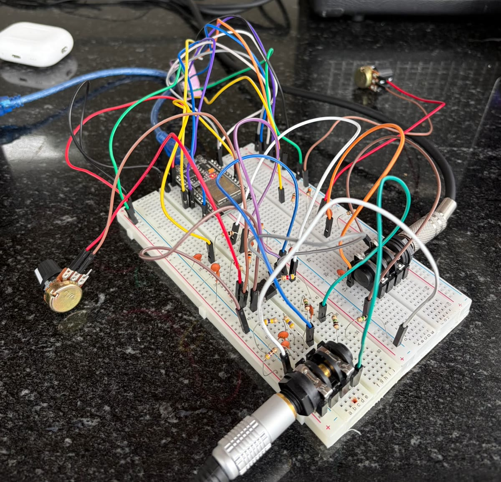
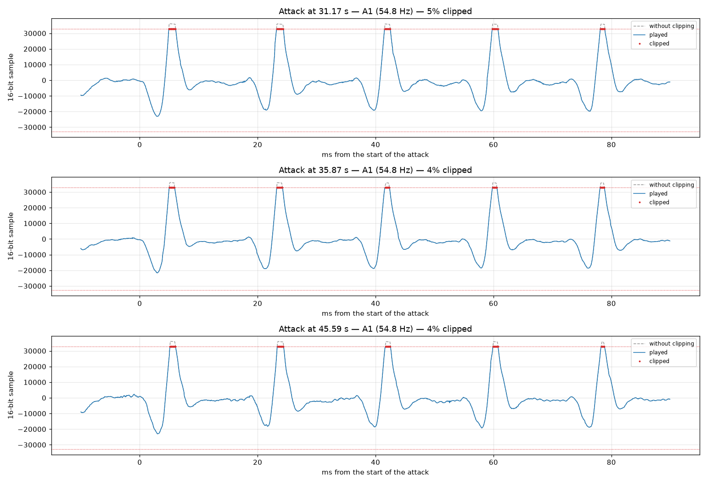
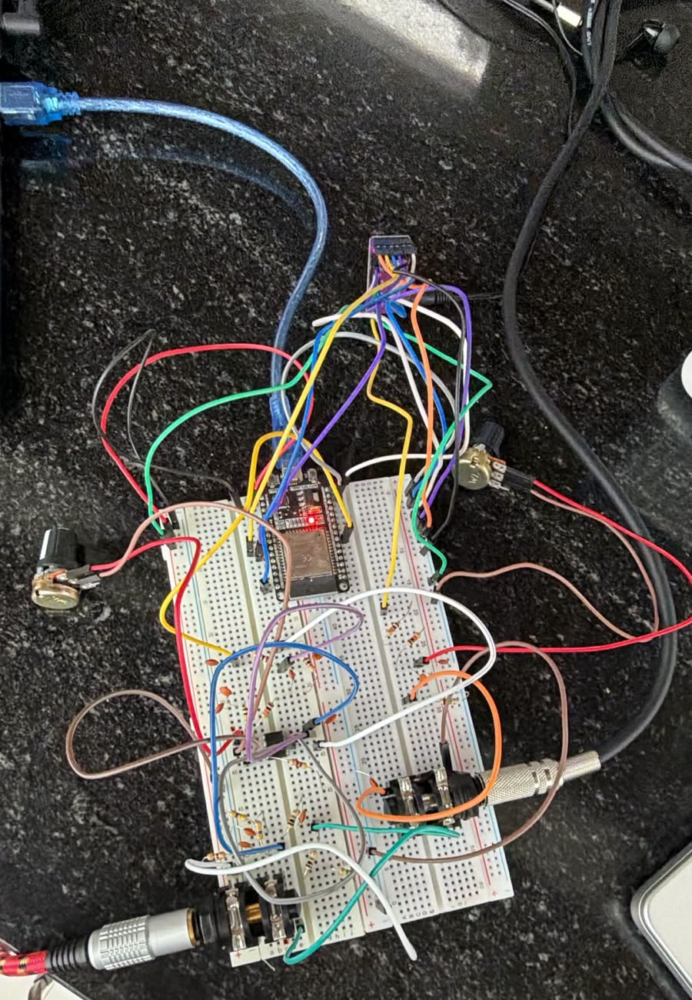
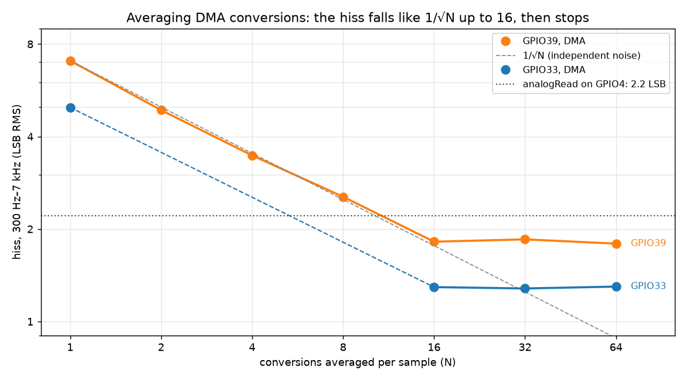
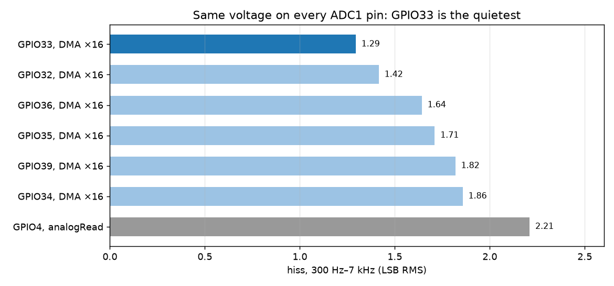
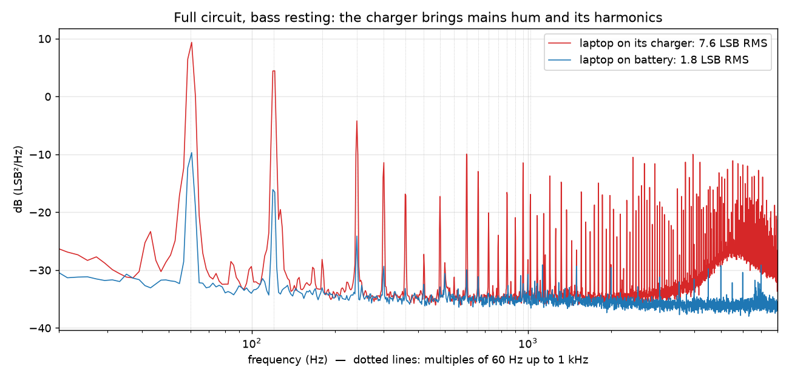

# Building a Digital Bass Pedal on an ESP32

https://github.com/user-attachments/assets/c89f3586-0b72-473c-83ae-9768305bff6b

*The pedal through a bass amp: clean, chorus and flanger on a held note, then distortion alone, with chorus and with flanger on a riff. Recorded with a phone in front of the amp.*

## Summary

- I built a bass effects pedal around an original ESP32, a board that costs a few euros. The bass goes through a small analog preamp into the ESP32's own ADC, the effects run on the chip at 48 kHz, and a PCM5102A DAC sends the result to the amp. It works end to end on a breadboard, with a noise gate, distortion, flanger and chorus.
- The built-in ADC was the main obstacle. Read with `analogRead`, one sample takes 41 µs, which caps the sample rate at about 20 kHz, and it hisses even with a steady voltage on its input.
- Switching to the ADC's continuous mode with DMA, averaging several conversions per sample, picking the quietest pin and taking the laptop off its charger raised the ratio between playing and resting from about 28 dB to about 40 dB.
- Most of the other problems were about timing (samples taken late, code fighting for the cache) and grounding (the laptop charger, the DAC's ground). A later version would use an external audio ADC.

## Why I built it

I play bass, and I wanted my own effects unit, built from parts I understand and can fix. It goes between the bass and the amp, like any other pedal. Most hobby DSP pedals are designed for guitar, and bass needs a little more care:

- **The low notes are very low.** The lowest note on a five-string bass is B0 at 30.9 Hz; on a four-string, E1 at 41.2 Hz. Anything in the chain that loses lows, or reacts slowly to them, shows up right away.
- **The low end has to stay solid.** A chorus or a distortion on the full signal makes a bass sound thin or muddy. Bass pedals often keep the lows clean, and I do the same: the distortion leaves everything below ~150 Hz untouched, and the chorus adds only a little to the low notes.

I didn't start from a spec sheet. The goal was to make it work first, then measure whatever was holding it back. Most of this post is about that second part.

## How it works

The signal path is: bass → analog front end → ADC → effects on the ESP32 → DAC → volume → amp. It all runs on an original ESP32 (two 240 MHz cores with a floating-point unit), using the chip's built-in ADC. The board also streams the processed signal to my PC over USB. The PC isn't part of the pedal: it is my test bench, where I watch the levels, change the settings and record.

*Signal chain of the pedal. The PC only shows levels, changes settings and records.*

### The analog front end

A bass pickup can't go straight into an ADC pin. Its signal is small, swings around 0 V, and comes from a source with high impedance. The ESP32's ADC only reads positive voltages, from 0 to about 3.1 V. One cheap chip, an MCP6002 dual op-amp powered from 3.3 V, fixes all of that. Because the op-amp runs on 3.3 V, its output can't go outside the pin's safe range: that protection comes for free.

| Problem | Fix | Values |
| --- | --- | --- |
| A passive pickup loses treble if the input loads it | High-impedance input into an op-amp buffer | ~670 kΩ |
| The signal is small | Gain set by a knob | 1× to 11× |
| The signal is AC, and the ADC reads only positive voltages | Block the DC and re-centre the signal at mid-supply | ~1.6 V bias |
| Anything above half the sample rate folds back as fake tones (aliasing) | 2nd-order low-pass filter (Sallen-Key) | ~10.7 kHz |
| The digital side makes the 3.3 V supply noisy | RC filter for a separate analog supply | 470 Ω + 100 nF |

**A bass waveform is lopsided.** The positive peaks are tall and narrow, and the troughs are wide and shallow. Over a thousand 50 ms windows of strong notes, the positive peak was on average 1.5× the negative one, and up to 1.8× on hard attacks. My first idea was to move the bias point down to use the range better. It didn't help: clipping just moved from the top of the range to the bottom. I went back to mid-scale, and the gain knob sets the headroom.

*Three strong attacks of an A1 (54.8 Hz): tall, narrow positive pulses and wide, shallow troughs. The flat tops (red) are the ADC hitting its maximum of 4095.*

*The breadboard from above: the ESP32 in the middle, the input and output jacks at the bottom, the gain and volume knobs on the sides, and the PCM5102A DAC module (the purple board) at the top.*

## The first version: analogRead at 16 kHz

The first firmware read the ADC with Arduino's `analogRead` on GPIO4, 16,000 times per second. One core did nothing but sample: it waited for the exact moment of each sample, read the ADC, ran the effects on that one sample and stored it in a block. The other core sent the blocks to the PC over USB serial. With no DAC yet, the PC was both my speaker and my measuring instrument.

**The firmware reports on itself.** Once per second it sends a small statistics packet: how late the latest sample was, how many samples were late, how long the reads took, how much spare time was left before the next sample, and how many CPU cycles the effects used. This turned out to be the most useful thing I built. More than once it explained a problem I could hear but not describe.

**PC tools, in Python.** `listen.py` shows the levels, records to a WAV file and sends the effect settings from the keyboard; `analyze.py` draws spectra and code histograms and points out mains-hum peaks; `view.py` shows the waveform, any clipping and the attacks.

**How I tested.** I recorded the raw ADC values whenever I could, so I could rerun any analysis later. I changed one thing at a time and compared against a recording made under the same conditions. Over about three weeks I kept a test diary of some twenty experiments, and the numbers in this post come from it.

### What went wrong, and how I found it

**The hum was the jack.** A rough hum that changed when I touched the strings came from a loose ground on the input jack. Tightening it cut the resting noise by 29–44% and removed most of the mains harmonics from 120 Hz to 1 kHz. On a breadboard, that contact is the first thing to check.

**The distortion that wasn't there.** The bass sounded heavily distorted, but the ADC values never got close to clipping. My listening script multiplied the signal by 8 before playback, which clipped 17.4% of the samples on the way to the headphones. I only found it because I had the raw recording and could replay it with other settings.

**Metallic notes: samples taken at the wrong moment.** High notes sounded metallic, as if doubled. In the spectrum, each harmonic had small copies at ±250 Hz around it, and 250 Hz was a clue: it is 16,000 ÷ 64, the rate at which the sampling loop stopped to send a block. If a sample is taken late, the error is the slope of the wave times the delay. Higher harmonics move faster, so their copies should grow by +6 dB per octave, and that is exactly what they did. The firmware's timing data confirmed it: two samples per block were up to 52 µs late. Moving the serial sending to the other core brought the lateness to 0 µs, and the metallic sound was gone.

*Top: spectrum of a G#3, with the harmonics (blue) and the ±250 Hz copy positions (red). Bottom: the copies grow +6 dB per octave across three notes, the signature of late samples.*

**Effects that cut in and out: the cache.** When I added the noise gate, the sound started to go up and down, cutting. The stats packets arrived every 1.43 s instead of every second: the loop was only taking about 11,200 samples per second. `analogRead` itself had slowed from 41 to 61 µs, though I hadn't touched it. On the ESP32, code normally runs from external flash through a small cache, and the gate code, plus math functions like `sqrtf`, kept pushing `analogRead` out of it. The fix was to put the audio code in IRAM, the internal instruction RAM that bypasses the cache, force the effect code to be inlined there, and avoid library calls in the loop. The problem came back once more when I added only the keyboard controls for the chorus, code that doesn't even run in the loop: the new functions had moved the sampling loop in flash, where it now clashed with `analogRead`. Moving the sampling loop itself into IRAM fixed it for good. This explanation fits every test, although I didn't read the CPU's cache counters to confirm it directly.

### The limits of analogRead

One `analogRead` took about **41 µs** of the 62.5 µs available per sample at 16 kHz. That caps software sampling at about 20 kHz and rules out the standard audio rates: at 48 kHz a whole sample period is 20.8 µs, half a single read. It also hisses on its own. With GPIO4 tied to a steady voltage from a resistor divider, the hiss between 300 Hz and 7 kHz was about **2.2 LSB RMS**, roughly 55–60 dB of dynamic range, or about 9 useful bits out of 12.

## Getting more out of the built-in ADC

Up to here I had been using GPIO4, which belongs to the ESP32's second ADC block, ADC2. Reading more about the chip, I found that ADC1 has a continuous mode: the hardware samples on its own and DMA moves the results to memory, so the CPU never waits for a conversion and the sample instants are set by the hardware. On the original ESP32 this mode only works on ADC1 (GPIO32 to 39), at 20 kHz to 2 MHz.

The first test was disappointing. Each single conversion was noisier than an `analogRead`, about 5–7 LSB, at any rate I tried between 32 kHz and 1 MHz. But conversions this fast leave room to take many of them per output sample and average them. With the ADC at 256 kHz and 16 conversions averaged into each 16 kHz sample, the hiss fell roughly as 1/√N, as expected for noise that is independent from one conversion to the next. Past 16 it stopped falling: 32 and 64 conversions gave the same result, so what is left doesn't average out.

*Hiss with the input tied to a steady voltage, for N conversions averaged per sample. It falls like 1/√N up to 16, then stays put. On GPIO33 only N = 1, 16, 32 and 64 were measured.*

The pins aren't equal either. With the same voltage on each ADC1 pin and 16 conversions per sample, GPIO33 had the least hiss, 1.3 LSB, and GPIO34 the most, 1.9 LSB. Every ADC1 pin, averaged, came out quieter than `analogRead` on GPIO4. I moved the input to GPIO33.

*The same steady voltage on each ADC1 pin, 16 conversions averaged per sample, against `analogRead` on GPIO4 (grey).*

With the whole circuit and the bass connected, though, the resting noise was about 8 LSB RMS, with strong peaks at 60 and 120 Hz and harmonics up to about 4 kHz, and touching the strings changed nothing. It was the laptop's charger, making a ground loop through the USB cable. On battery, the same setup measured 1.8 LSB RMS, close to the ADC's own floor. Since then I measure noise only with the laptop on battery.

*Full circuit with the bass resting: laptop on its charger (red) and on battery (blue).*

Playing, the signal now measured about 191 LSB RMS. The ratio between playing and resting went from about **28 dB** in the first version to about **40 dB**. Both numbers are measured the same way, the RMS while playing over the RMS at rest, so the comparison holds. There is still room to raise the input gain by about 1.5×.

## The output: a DAC at 48 kHz

The PCM5102A takes the samples over I2S and makes its own clocks from the bit clock, so it needs no master clock. That matters on the original ESP32, which can only output one on GPIO0, 1 or 3, a boot pin and the two USB serial pins. The ADC's continuous mode uses the I2S0 peripheral internally, so the DAC runs on I2S1, on GPIO18, 19 and 23, on the other side of the board from the input. Its XSMT pin has to be tied high, or the chip stays muted. After the DAC, two 10 kΩ resistors and a 10 kΩ volume knob bring its 2.1 V RMS down to about 0.7 V RMS, and a 100 nF capacitor blocks any DC.

I first kept the 16 kHz rate. Through the amp there was a hiss that no digital filter could remove: the DAC's own noise outside the audio band, and the images of the signal, sat just above 8 kHz, well within hearing. At 48 kHz they move above 24 kHz. The ADC now runs at 8 × 48 kHz = 384 kHz and averages 8 conversions per sample. Averaging more made it worse: with 12 or 16 conversions, the ADC has to run at 576 or 768 kHz, and the hiss went from about 2 to about 3.5 LSB. The faster conversions were noisier, and averaging couldn't make up for it.

The firmware reads DMA frames of 32 samples, 0.67 ms each, averages them, runs the effects and writes the result to the DAC. The signal stays in floating point from the average to the DAC, and a soft limiter in front of the DAC rounds off peaks above about three quarters of full scale. The PC still gets a copy of the processed signal at 16 kHz.

### Noise after the DAC

Connecting the output brought a new round of noise problems. Most came down to power and grounding, and some taught me to be careful about what a test really proves.

- **A DAC that wasn't powered.** With the module's supply pin not properly connected (it measured 1.5 V), the chip powered itself through the I2S pins. It made no sound, and the input picked up strong interference: a tone around 7 kHz, and the resting level shifted by about 300 codes.
- **The output leaking into the input.** With the DAC sending only zeros, the resting noise at the input fell from 7.3 to 2.9 LSB. Moving the I2S lines away from the input pin didn't help, which points to the DAC's ground, shared with the input on the breadboard, rather than to crosstalk from the data line.
- **An op-amp that oscillated.** After a rebuild, the MCP6002 started to oscillate. Its output reaches the ADC pin through a 100 Ω resistor and a 10 nF capacitor that holds charge for each conversion, and that resistor was too small to isolate the op-amp from the capacitor. The analog supply dropped to 2.1 V and the ADC jumped between 0 and 4095, while a multimeter only showed the average, about half the supply. A 1 kΩ resistor stopped it.
- **A DAC that mutes itself.** The PCM5102A goes silent on its own after a stretch of zeros. So when the noise gate made the hiss disappear, that didn't prove the hiss came from the input: the DAC had simply switched off.
- **The amp's ground helps.** With the amp's cable connected, its mains earth also grounds the circuit: the resting noise was 3.2 LSB, against 12.7 LSB, mostly 120 Hz, with the amp unplugged.

## The effects

The effects run on the ESP32, one sample at a time, in this order: noise gate, distortion, flanger, chorus, and the output limiter. They always compute, even when switched off, so turning one on never changes the timing. With everything on, the worst sample takes about 2,300 of the roughly 5,000 CPU cycles available at 48 kHz. For now they are switched and adjusted from the PC. The video at the top plays each of them.

**Noise gate.** My first gate was a simple switch: mute when the signal drops below a threshold. It cut low notes in the middle: an E at 41 Hz has one cycle every 24 ms, and between peaks the level detector dropped enough to close the gate. I rebuilt it as an expander. It measures the level as an RMS average over 40 ms, which stays steady on low notes, and below the threshold it lowers the volume gradually instead of cutting it. On the first version, the resting noise dropped from about 10.6 to 0.1–0.5 LSB RMS, with no dips inside notes and no clicks.

**Distortion.** Below about 150 Hz the signal passes clean, so the low end stays solid. Above it, the signal gets 20 dB of gain (adjustable from 0 to 40), a soft clipper and a low-pass filter at about 3 kHz to take the edge off. The clipper first used an approximation of tanh with a division per sample, which pulled code from flash into the loop. A cubic curve does the same job with multiplications only.

**Flanger.** Half of the signal is mixed with a copy delayed by 0.2 to 4 ms, the delay is swept by a slow oscillator, and part of the delayed signal is fed back. The feedback sharpens the sweep, but it also amplifies the hiss in the pauses: at 0.9 the resting noise went from 4.3 to 19.8 LSB. It works best with the gate on.

**Chorus.** Two voices read the same delay line around 12 ms, swinging in opposite directions by up to 8 ms. On bass, mixing the signal with an equal copy 12 ms later cuts a notch right at 42 Hz, the fundamental of the low E: 17 to 36 dB deep. Below 120 Hz the voices go in at about a third of the mix, which keeps that notch under ~6 dB while the low notes still get some movement.

I also tried an auto-wah, and dropped it: I didn't like how it sounded on bass.

## The numbers

| | First version | This version |
| --- | --- | --- |
| Sampling | `analogRead` on GPIO4, software-timed, 16 kHz | ADC1 in continuous mode with DMA on GPIO33, 384 kHz, mean of 8 → 48 kHz |
| CPU time spent reading the ADC | ~65% of each sample | none: the hardware samples |
| ADC hiss, input on a steady voltage (300 Hz–7 kHz) | 2.2 LSB | 1.3 LSB (GPIO33, 16 conversions per 16 kHz sample) |
| Playing vs. resting, full circuit with the bass | ~28 dB | ~40 dB |
| Output | PC only, over USB | PCM5102A DAC at 48 kHz |
| Effects | gate + chorus, ~700 of 15,000 cycles per sample | gate, distortion, flanger, chorus, limiter: ~2,300 of ~5,000 cycles |

## Known limitations

- Some hiss is still audible through the amp. A digital filter doesn't remove it, and the most likely cause is how the DAC module is grounded on the breadboard.
- A short burst of noise comes about every 640 ms from the digital side. I ruled out the jack, the charger, the USB port, the ADC block, the bass cable, the op-amp and the serial traffic (by recording to RAM with the serial link stopped), but I didn't find the source.
- I haven't measured the latency from input to output.

## Next version: an external audio ADC

This version shows how far the ESP32's own ADC can go, and where it stops. The next step is a dedicated audio ADC such as the PCM1808, whose datasheet gives 99 dB, against the 55–60 dB of dynamic range I measured on the built-in ADC. It would also share the I2S clock with the DAC, so input and output could never drift apart, and the CPU would no longer have to average conversions. The same front end works with it, and the table above becomes the "before" to compare against. One thing to plan for: the PCM1808 needs a master clock at 256 times the sample rate, which the original ESP32 can only output on GPIO0, 1 or 3.

## What I learned

- **Record the raw data.** The "distortion" came from my own playback script. I only found that because I could replay the raw recording with other settings.
- **Let the device report on itself.** One small stats packet per second caught problems I could hear but couldn't explain by ear.
- **The shape of a problem points to its cause.** Copies that grow +6 dB per octave mean a timing error, not interference.
- **On a chip with a cache, where code lives is part of its cost.** An effect costs its own cycles plus what it does to the code around it.
- **Averaging only removes noise that changes from one reading to the next.** Past 16 conversions, more averaging bought nothing.
- **Ground is part of the circuit.** The charger, the DAC's ground and the amp's earth each changed the noise more than any code did.
- **Check what a test actually proves.** A DAC that mutes itself on silence makes any noise look like it came from the input.
- **Change one thing at a time.** My first attempt at averaging changed three things at once, sounded terrible, and taught me nothing about which one was wrong.
