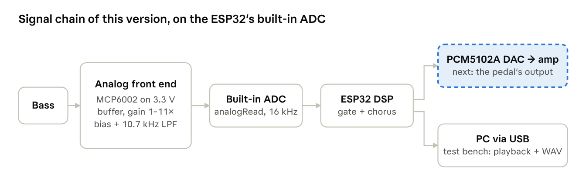
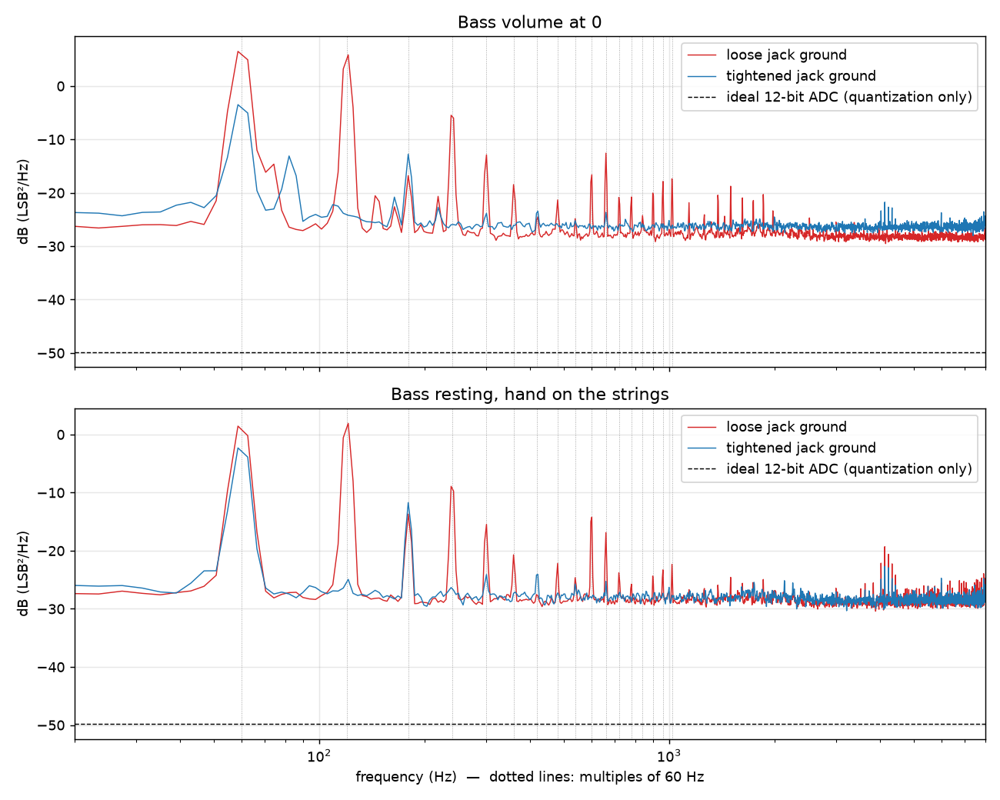
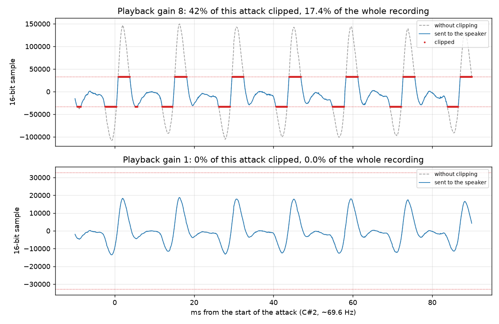
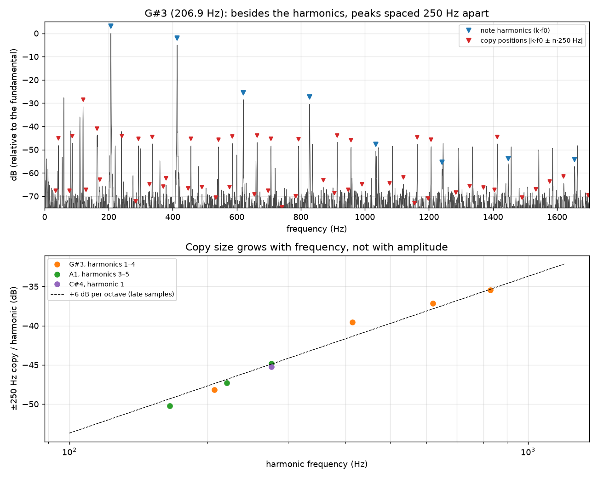
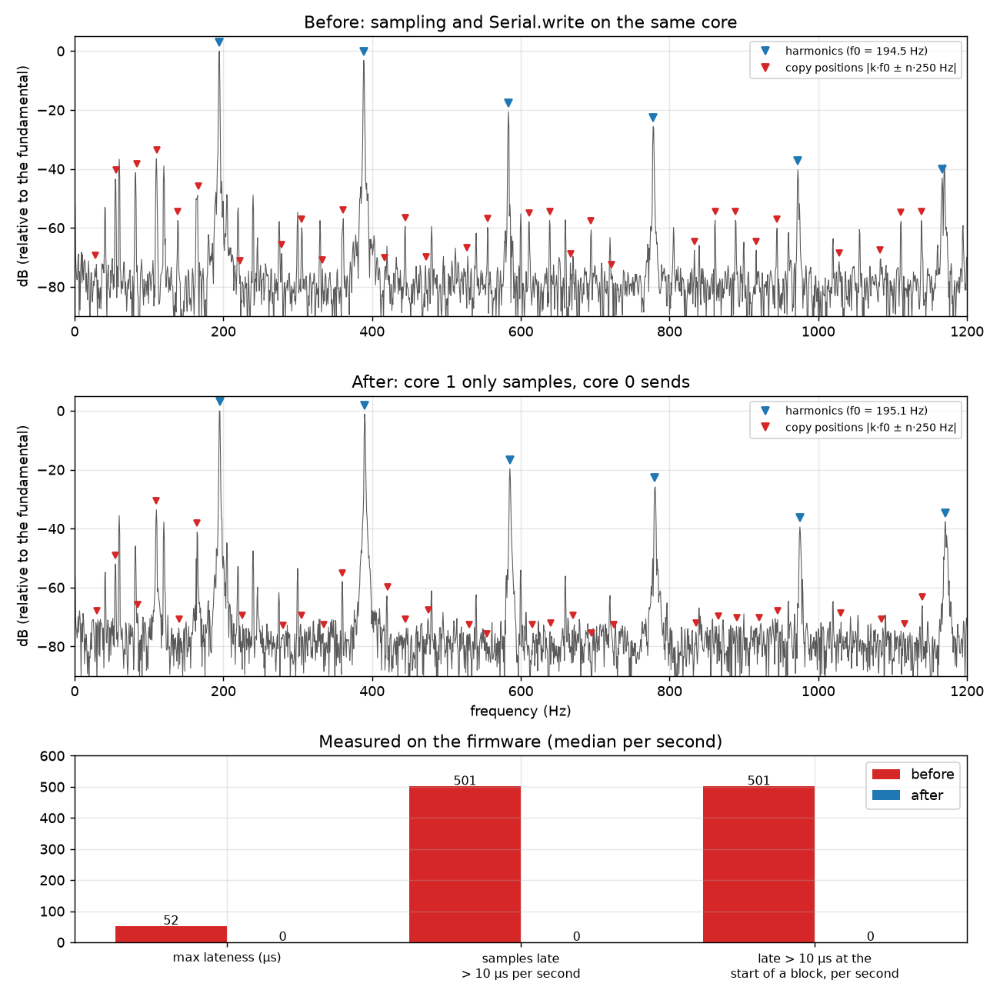
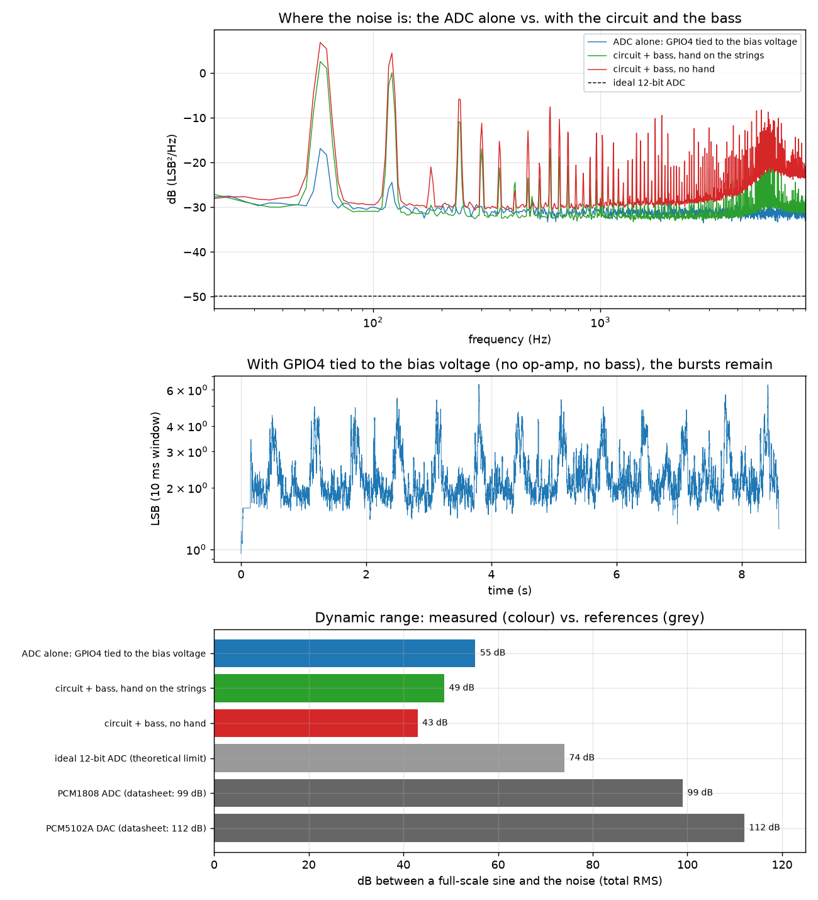
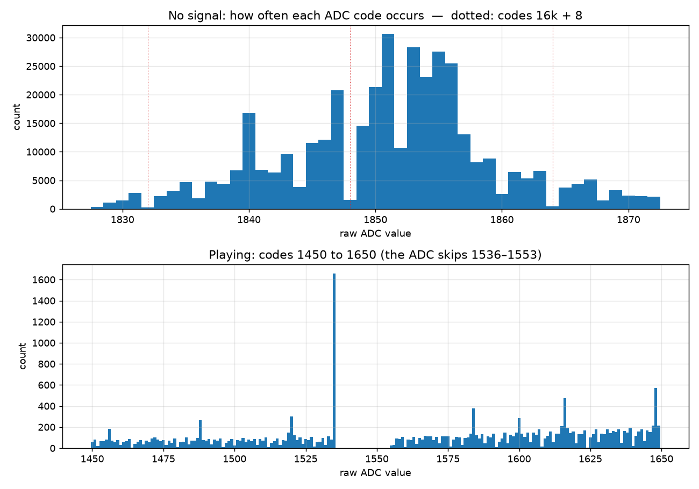
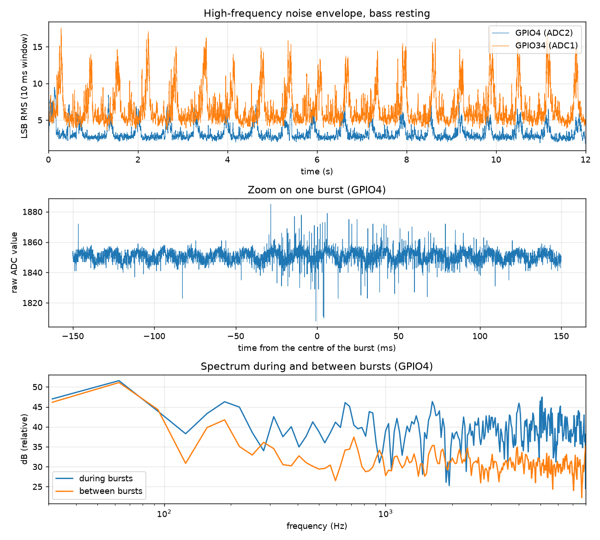
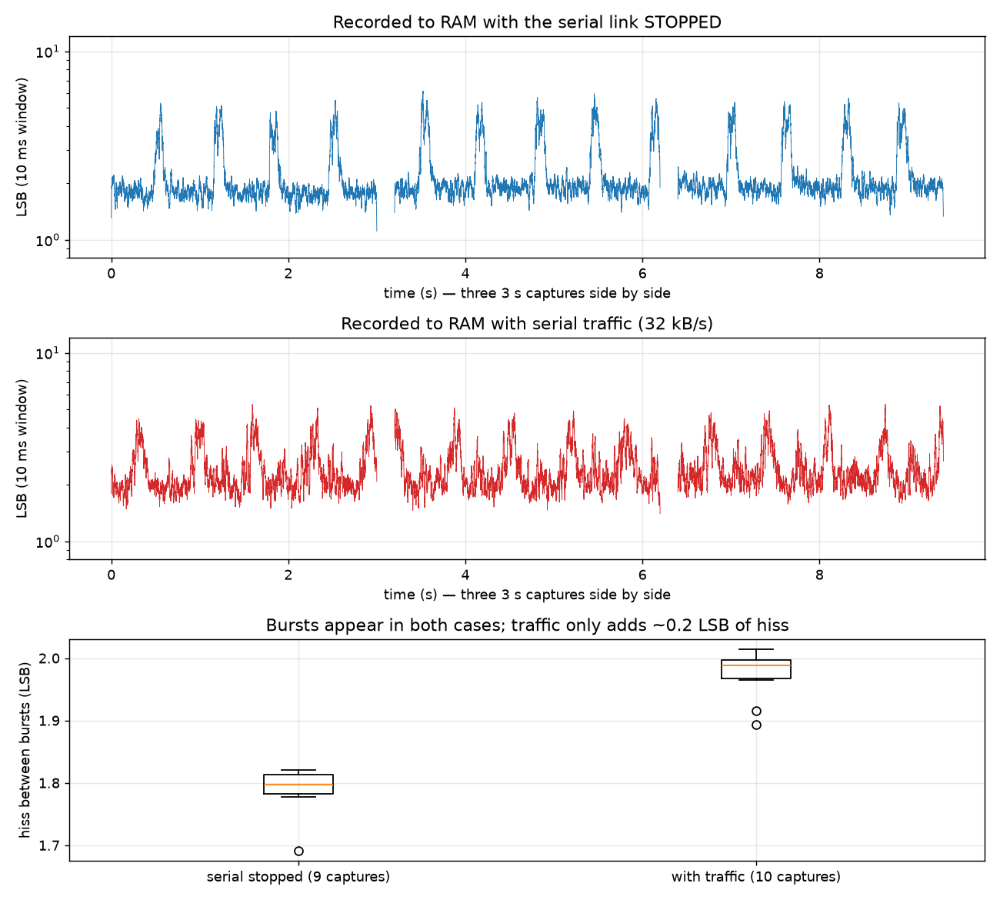
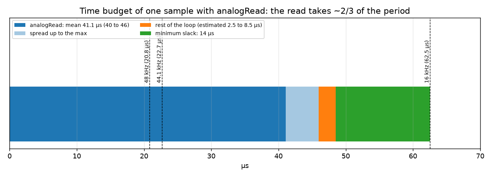

# Building a Digital Bass Pedal on an ESP32 (draft)

*Draft markers: **[TBD]** = not done yet (external ADC, DAC, latency). **[NOTE]** = may still change. **[FIG]** = planned figure.*

## TL;DR

- I'm building a bass effects pedal on an original ESP32, a board that costs a few euros. The input side is done: the bass goes into the ESP32 and a noise gate and a chorus run on the chip. With no output stage yet, I stream the audio to my PC and listen there, using the board as a makeshift audio interface for testing.
- The weak point is the ESP32's built-in ADC. With its input tied to a steady voltage it still hisses: about **55 dB** of dynamic range, or roughly **9 useful bits out of 12**.
- It is also slow. One reading takes **41 µs**, two thirds of the time I have per sample at 16 kHz. That leaves little room for effects and rules out standard audio rates like 48 kHz.
- Two timing bugs had me fooled. A serial write inside the sampling loop made high notes sound metallic. Later, adding *unrelated* code dropped the sample rate from 16 to 11 kHz, because of instruction-cache conflicts.
- Next step: a dedicated audio ADC (PCM1808) and DAC (PCM5102A) sharing one I2S clock. **[TBD]** results.

## Why I'm building this

I play bass, and I wanted my own effects unit, built from parts I understand and can fix. It goes between the bass and the amp, like any other pedal. Most hobby DSP pedals are designed for guitar, and bass needs a little more care:

- **The low notes are very low.** The lowest note on a five-string bass is B0 at 30.9 Hz; on a four-string, E1 at 41.2 Hz. Anything in the chain that loses lows, or reacts slowly to them, shows up right away.
- **The low end has to stay solid.** A chorus or a distortion on the full signal makes a bass sound thin or muddy. Bass pedals often split the signal: below ~150 Hz it passes clean, and only the rest gets the effect. I do the same here.

I didn't start from a spec sheet. The goal was to make it work first, then measure whatever was holding it back. Most of this post is about that second part.

What I wanted from it:

- low B that sounds clean and full;
- no hiss or hum I can hear at normal volume;
- no delay I can feel while playing;
- cheap, easy-to-find parts;
- a button and an LED per effect.

## How it works

The signal path is: bass → analog front end → ADC → effects on the ESP32 → DAC → volume → amp. There are two versions of the hardware, both on an original ESP32 (two 240 MHz cores with a floating-point unit):

- **Prototype A (working today)** uses the ESP32's built-in ADC. I built the input side first. With no DAC connected yet, I send the audio to my PC over USB and listen through headphones, so for testing the board works as a simple audio interface.
- **Prototype B (in progress)** keeps the same front end, but uses a dedicated audio ADC and DAC that share one clock.

*Signal chain of Prototype A (measured) and Prototype B (in progress).*

Both prototypes share the front end. B replaces software sampling and the PC with converters clocked by I2S.

### The analog front end

A bass pickup can't go straight into an ADC pin. Its signal is small, swings around 0 V, and comes from a source with high impedance. The ESP32's ADC only reads positive voltages, from 0 to about 3.1 V. One cheap chip, an MCP6002 dual op-amp powered from 3.3 V, fixes all of that. Because the op-amp runs on 3.3 V, its output can't go outside the pin's safe range: that protection comes for free. **[FIG]** Front-end schematic.

| Problem | Fix | Values |
| --- | --- | --- |
| A passive pickup loses treble if the input loads it | High-impedance input into an op-amp buffer | ~670 kΩ |
| The signal is small | Gain set by a knob | 1× to 11× |
| The signal is AC, and the ADC reads only positive voltages | Block the DC and re-centre the signal at mid-supply | ~1.6 V bias |
| Anything above half the sample rate folds back as fake tones (aliasing) | 2nd-order low-pass filter (Sallen-Key) | ~10.7 kHz |
| The digital side makes the 3.3 V supply noisy | RC filter for a separate analog supply | 470 Ω + 100 nF |

**A detail I didn't expect: a bass waveform is lopsided.** The positive peaks are tall and narrow, and the troughs are wide and shallow. Over a thousand 50 ms windows of strong notes, the positive peak was on average 1.5× the negative one, and up to 1.8× on hard attacks. My first idea was to move the bias point down to use the range better. It didn't help: clipping just moved from the top of the range to the bottom. It also put the resting point right next to a band of codes the ADC skips (more on that below). I went back to mid-scale, and the gain knob now sets the headroom.

*Three strong attacks of an A1 (54.8 Hz): tall, narrow positive pulses and wide, shallow troughs. The flat tops (red) are the ADC hitting its maximum of 4095.*

## Prototype A: making it work with the built-in ADC

The first version reads the ADC with Arduino's `analogRead`, 16,000 times per second, and sends every raw sample to the PC. With no DAC yet, the PC does two jobs: it is my speaker and my measuring instrument.

**Firmware.** One core does nothing but sample. It waits for the exact moment of each sample, reads the ADC, runs the effects on that one sample, and stores it in a block of 64. The other core sends the full blocks over USB serial at 921,600 baud. Each sample takes two bytes, and the top bit marks the first byte, so the PC can resync if a byte gets lost.

**The firmware reports on itself.** Once per second it sends a small statistics packet. It contains how late the latest sample was, how many samples were late, how long `analogRead` took, how much spare time was left before the next sample, and how many CPU cycles the effects used. This turned out to be the most useful thing I built. Twice it showed a bug that I could hear but couldn't explain.

**PC tools, in Python:**

- `listen.py` plays the stream through my headphones with a small buffer (30–75 ms). It records the raw ADC values to a WAV file and lets me change effect settings with the keyboard while I play.
- `analyze.py` draws the waveform, spectrogram, noise spectrum and a histogram of ADC codes, and points out peaks at mains-hum frequencies.
- `view.py` compares what the ADC read with what I heard, and marks any clipping.

**How I tested.** I always recorded the *raw* ADC values, never the processed sound, so I could rerun any analysis later. I changed one thing at a time and compared against a recording made under the same conditions. Before putting a new effect on the board, I ran the same algorithm in Python on old recordings. Over four days I kept a test diary of 18 experiments, and every number in this post comes from it.

## What went wrong, and how I found it

Each problem started as a sound I didn't like and ended with a number that explained it. They showed up roughly in this order, and fixing one often uncovered the next.

| What I heard | What it actually was | Fix |
| --- | --- | --- |
| Rough hum that changed when I touched the strings | Loose ground on the input jack | Tighten, then solder **[TBD]** |
| Heavy distortion | My own PC script clipping 17% of samples | Lower its gain |
| Metallic, "doubled" high notes | Samples taken up to 52 µs late, 250 times a second | Split the work across the two cores |
| Constant hiss | The ESP32's ADC itself | A dedicated audio ADC |
| Hiss pulsing about 1.5 times a second | Something on the digital side; still open | Probably the external ADC |
| Effects "cutting in and out" | The sample rate collapsing to 11 kHz because of cache conflicts | Move the audio code to internal RAM (IRAM) |

### 1. The hum was the jack

Tightening the ground of the input jack cut the resting noise by 29–44% and removed most of the mains harmonics, from 120 Hz up to 1 kHz. A day later, with the jack still unsoldered, the hum was back. The fix is a soldering iron. **[TBD]** Re-measure after soldering.

*Noise spectrum with the jack ground loose (red) and tightened (blue). Dotted lines are multiples of 60 Hz; the dashed line is the floor of an ideal 12-bit ADC.*

### 2. The distortion that wasn't there

The bass sounded heavily distorted, but the ADC values never got close to clipping. The culprit was my listening script. It multiplied the signal by 8 before playback, which clipped 17.4% of the samples on the way to the headphones. I only found it because I had recorded the raw values and could replay them with different settings.

*The same attack replayed with the script's old gain of 8 (top: peaks flattened in red) and with gain 1 (bottom: the full wave).*

### 3. Metallic notes: samples taken at the wrong moment

With the clipping fixed, high notes still sounded metallic, as if doubled. In the spectrum, each harmonic had small copies at ±250 Hz around it. 250 Hz was a clue: it is 16,000 ÷ 64, the rate at which the firmware stopped to send a block over serial.

The size of the copies told me the cause. If a sample is taken late, the error is the slope of the wave times the delay. Higher harmonics move faster, so their copies should grow by +6 dB per octave, and that is exactly what they did. The firmware's own timing data confirmed it: two samples per block were up to 52 µs late. After I moved the serial sending to the other core, lateness dropped to 0 µs, the copies sank into the noise, and the metallic sound was gone.

*Top: spectrum of a G#3, with the harmonics (blue) and the ±250 Hz copy positions (red). Bottom: the copies grow +6 dB per octave across three notes, the signature of late samples.*

*The same note before and after moving the serial sending to the other core: the copies sink into the noise, and the lateness measured by the firmware drops to zero.*

### 4. The hiss is the ADC itself

To find out how much hiss the ADC adds on its own, I wired its pin straight to a steady 1.6 V: no op-amp, no bass, no jack. It still hissed: 2.5 LSB RMS, which is about **55 dB** of dynamic range, or roughly **9 useful bits out of 12**. For comparison, the PCM1808's datasheet promises 99 dB. With my hand on the strings, the high-frequency noise of the full setup matched the bare ADC, so the analog circuit isn't the problem. The ADC also skips whole ranges of codes: 18 values just above 1536, 4 above 2048, 23 above 2560. The other ADC block (ADC1) was twice as noisy.

*Top: with a hand on the strings, the high-frequency floor of the full chain (green) matches the bare ADC (blue); the rest is hum. Bottom: measured dynamic range against the ideal 12-bit limit and the datasheet values of the PCM1808 and PCM5102A.*

*How often each ADC code occurs. Codes 1536–1553 never show up, and 1535 collects their counts.*

### 5. A pulsing hiss I haven't solved yet

There is also a burst of noise every ~640 ms, lasting 30–100 ms. I tested the suspects one at a time: the jack ground, the laptop charger, the USB port, the other ADC, the bass cable, the op-amp, and even the data transfer (recording to RAM with serial fully stopped). The bursts survived every test, so they come from the digital side: the chip, its power, or USB. **[NOTE]** Still open. I expect the external ADC to get rid of them; check in Prototype B.

*The high-frequency noise envelope with the bass resting: regular peaks every ~640 ms, on both ADC blocks. Each burst is a cluster of spikes spread over the whole band.*

*Recorded to RAM with the serial link stopped (top) and with traffic (middle): the bursts are there either way.*

### 6. Effects that cut in and out: the cache

One `analogRead` takes **41 µs** of the 62.5 µs I have per sample at 16 kHz. That leaves about 14 µs for everything else. It also means 44.1 and 48 kHz are impossible: at those rates a whole sample period is shorter than a single read. And the effects have to run one sample at a time, inside the sampling loop.

*Time budget of one sample at 16 kHz, measured on the board: `analogRead` alone takes ~41 of the 62.5 µs. The dashed lines show the whole period at 44.1 and 48 kHz, both shorter than a single read.*

When I added the noise gate, the sound started to "go up and down, cutting". The stats packets explained it: they arrived every 1.43 s instead of every second. The loop was taking only ~11,200 samples per second, and the PC kept running out of audio. Strangely, `analogRead` itself had slowed from 41 to 61 µs, even though I hadn't touched it.

On the ESP32, code normally runs from external flash through a small cache. My gate code, plus math functions like `sqrtf`, also lived in flash and kept pushing `analogRead` out of the cache. Every time it came back, the CPU stalled while it reloaded. After 11 firmware variants, each changing one thing, the fix was:

- put the audio code in IRAM, the ESP32's internal instruction RAM, so it never goes through the cache;
- force the effect code to be inlined into that function, so none of it stays behind in flash;
- avoid library calls in the loop (no square roots, no `sinf`).

The gate then cost 278 CPU cycles, and the rate went back to 16 kHz. Then the collapse came back when I added only the keyboard controls for the chorus, code that doesn't even run in the loop. Adding functions had shifted where the sampling loop sat in flash, so it now clashed with `analogRead` in the cache. Moving the sampling loop into IRAM as well fixed it for good: 0 late samples and 9–10 µs to spare. **[NOTE]** The cache explanation fits every test, but I haven't read the CPU's cache counters to confirm it directly.

The takeaway: the effects themselves are cheap, so the real cost is the way the samples are taken.

## Effects running on the chip

Two effects run on the ESP32 today, using about 700 of the 15,000 CPU cycles available per sample. They always compute, even when switched off, so turning one on never changes the loop's timing.

### Noise gate, rebuilt for bass

My first gate was a simple switch: mute when the signal drops below a threshold. It cut low notes in the middle. An E at 41 Hz has one cycle every 24 ms, and between peaks the gate's level detector dropped enough to close it. I rebuilt it as an *expander*. It measures the level as an RMS average over 40 ms, which stays steady on low notes, and below the threshold it lowers the volume gradually instead of cutting it. Resting noise dropped from ~10.6 to 0.1–0.5 LSB RMS, with no dips inside notes and no clicks. A muted note now fades out smoothly in about half a second.

### Chorus that leaves the low end alone

A chorus mixes the signal with a slightly delayed copy and keeps varying the delay, here between 8 and 16 ms in a 1.25 s cycle. On bass I apply it only above ~150 Hz, and the lows pass straight through. Mix, depth and speed can be changed live from the keyboard, and the default settings sounded good to me as they are.

To check that it does what I designed, and not just that it "sounds like a chorus", I used the *cepstrum*. Mixing a signal with a delayed copy leaves a regular comb pattern in its spectrum, and the cepstrum turns that pattern into a single peak at the delay. With the chorus on, that peak followed the 1.25 s cycle (correlation 0.50, against at most 0.16 for other cycle lengths). With it off, nothing stood out. **[FIG]** New figure: cepstral peak vs. the chorus sweep.

### Next effects

**[TBD]** Overdrive (low end kept clean), compressor and delay. The overdrive is the reason the hiss matters so much: its gain amplifies the ADC's hiss together with the bass.

## Prototype B: a real audio ADC and DAC

I bought a PCM1808 audio ADC for two reasons: the hiss, and the time `analogRead` eats. Moving the conversion off the chip fixes three things at once:

1. **Less noise.** The datasheets give 99 dB for the PCM1808 and 112 dB for the PCM5102A DAC, against the ~55 dB I measured on the built-in ADC.
2. **Much more CPU time.** The I2S hardware collects the samples with DMA, so the CPU only has to finish each block before the next one arrives. At 48 kHz a 64-sample block lasts 1.33 ms, about 320,000 cycles. In Prototype A I had about 2,400 spare cycles per sample.
3. **Exact timing.** The I2S clock sets the sample moments, not a software loop, so problems 3 and 6 can't happen anymore.

**How it's wired.** The ESP32 drives a single I2S clock, and both the PCM1808 (input) and the PCM5102A (output) use it. Input and output then can never drift apart, which was a real problem when playing through the PC. DMA fills a block, an audio task processes it, and DMA sends it out. The buttons and LEDs run on the other core. **[FIG]** Block diagram of Prototype B.

**Output.** A 22 kΩ resistor and a 10 kΩ volume knob bring the DAC's line level (2.1 V RMS) down to about 0.66 V RMS, which suits a bass amp input.

**[NOTE]** Original-ESP32 details to check while wiring: the PCM1808 needs a master clock at 256 × the sample rate, and the original ESP32 can only output it on GPIO0, 1 or 3. GPIO0 is a boot pin, and GPIO1/3 are the USB serial pins. The I2S pins from the old S3 plan (12/13/14) include GPIO12, which is a boot strapping pin on the original ESP32. Block size: **[TBD]** 32 or 64. Sample rate: **[TBD]** 48 kHz.

**[NOTE]** The hiss is clearly the ADC's (problem 4). The pulsing bursts (problem 5) might also come from the board's power or ground, so test them again here.

## Before and after

Both prototypes go through the same tests: the input tied to a steady voltage, the bass resting, and the bass playing. **[TBD]** Every Prototype B number.

| | Prototype A (built-in ADC) | Prototype B (PCM1808 + PCM5102A) |
| --- | --- | --- |
| Sample rate | 16 kHz, software-timed (max ~20 kHz) | **[TBD]** 48 kHz, set by the I2S clock |
| ADC alone: dynamic range | ~55 dB (~9 useful bits) | **[TBD]** (datasheet: 99 dB) |
| Full chain, bass resting | 4.1 LSB RMS (~51 dB) | **[TBD]** |
| Skipped ADC codes | Yes: 4 to 23 at a time | **[TBD]** |
| Pulsing hiss | ~1.5 bursts per second | **[TBD]** |
| CPU time spent just reading the ADC | ~65% | **[TBD]** |
| Gate + chorus | ~700 cycles per sample | **[TBD]** cycles per block |
| Delay from string to speaker | Not measured | **[TBD]** ms |

**[TBD]** How to measure the delay: send a click into the input and record the input and the output at the same time on two channels, then measure the gap between them.

## What I learned

- **Record the raw data.** The "distortion" came from my own playback script. I only found that because I could replay the raw recording with other settings.
- **Let the device report on itself.** One small stats packet per second caught two bugs that I could hear but couldn't explain by ear.
- **The shape of a problem points to its cause.** Copies that grow +6 dB per octave mean a timing error, not interference or aliasing.
- **On a microcontroller with a cache, where code lives is part of its cost.** An effect costs its own cycles plus what it does to the code around it.
- **Change one thing at a time.** My first attempt changed three things at once, sounded terrible, and taught me nothing about which one was wrong.

## What's next

- The output side (Prototype B), which turns this into a real pedal, and filling in the table above.
- Footswitches with an LED per effect, in a metal enclosure.
- More effects: overdrive, compressor and delay.
- A PCB to replace the breadboard.

Code, PC tools and raw recordings: **[TBD: GitHub link]**. Video: **[TBD: YouTube link]**.

## Draft notes (remove before publishing)

The figures above were regenerated in English from the raw recordings by `docs/make_figures.py`. The attack figure comes from `tools/view.py`, and the signal chain is a capture of the diagram in the Claude Docs version. For Medium, it may be worth cutting down to the strongest few: the signal chain, the ±250 Hz copies, the ADC noise floor and the time budget.

| Figure | Where | Status |
| --- | --- | --- |
| Front-end schematic | Analog front end | **[TBD]** Redraw from the hardware notes |
| Sample rate for each firmware variant | Problem 6 | **[TBD]** New |
| Cepstral peak following the chorus sweep | Chorus | **[TBD]** New |
| Block diagram of Prototype B | Prototype B | **[TBD]** New |
| Noise spectrum, A vs. B | Before and after | **[TBD]** New |

**Other versions to derive from this one:**

- [ ] LinkedIn post: 5–6 lines, one figure, link to the Medium article.
- [ ] README section on GitHub linking to the article.
- [ ] Video script following the same order: why → how it works → problems → Prototype B.
